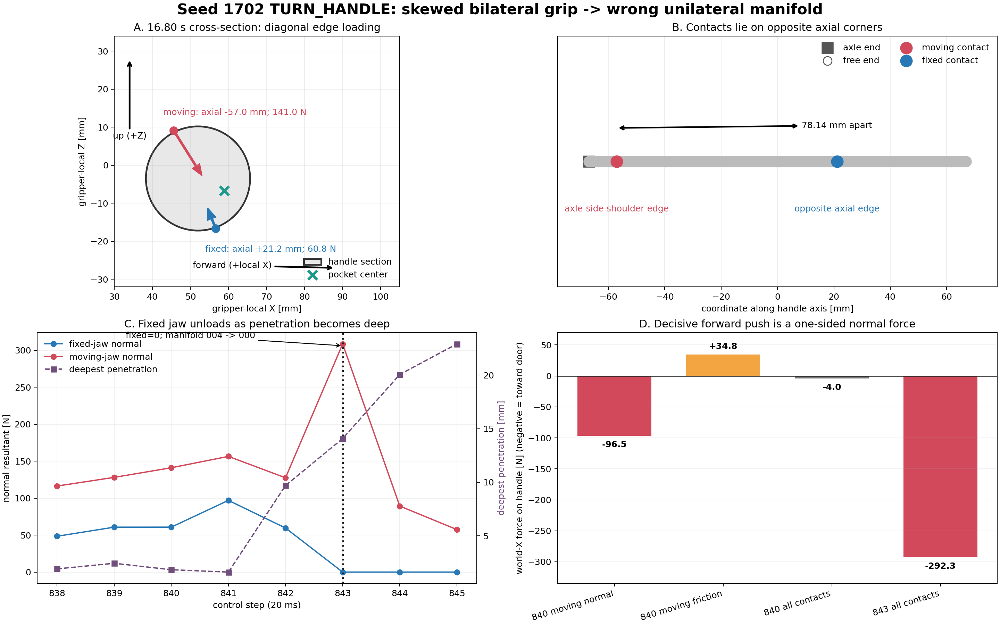
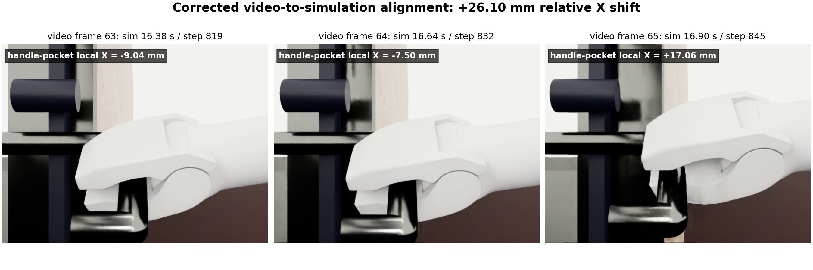
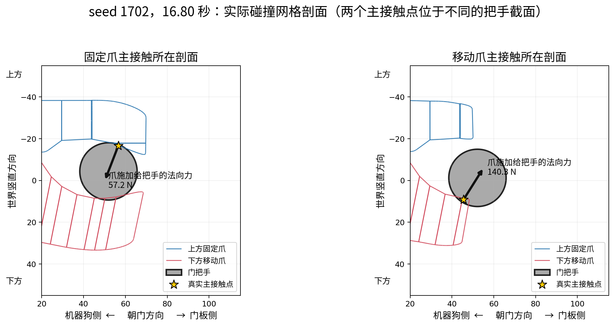
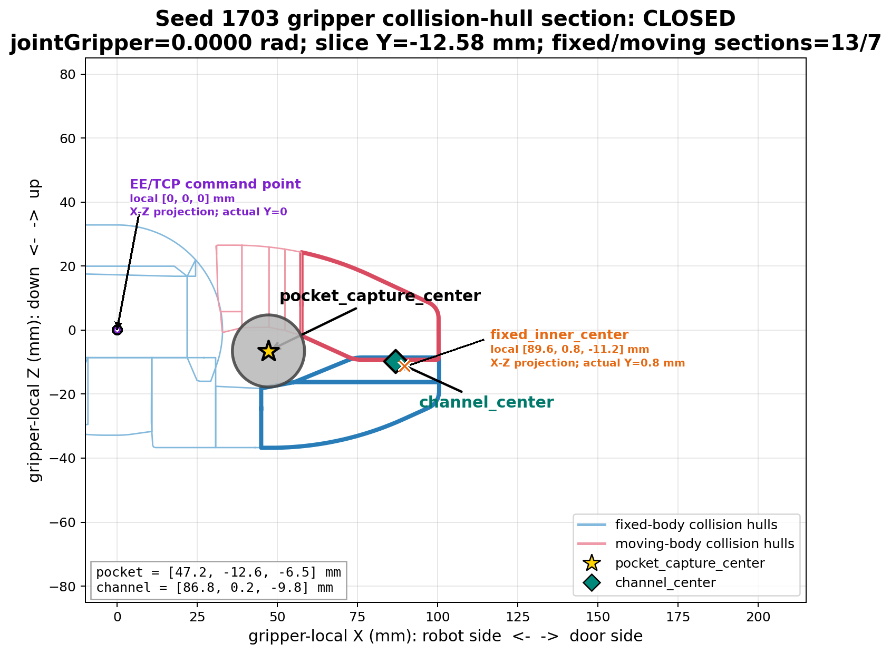
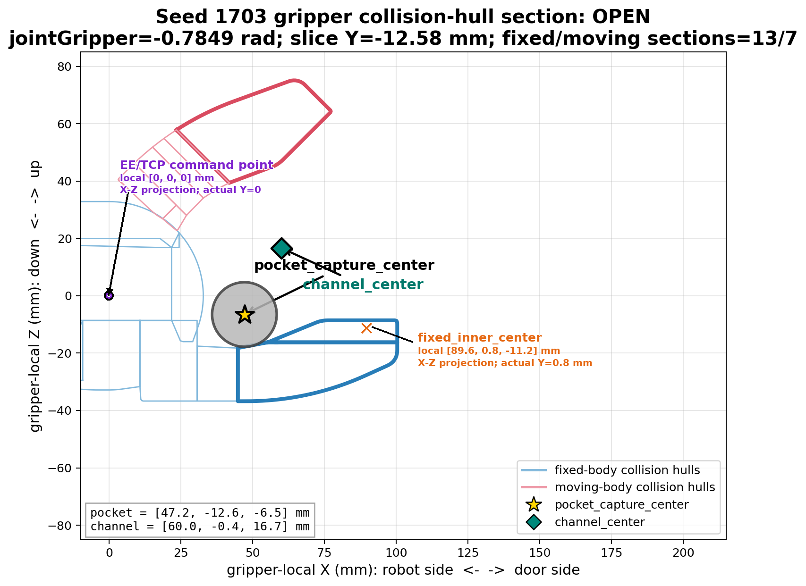

# AutoOpen 单 App GPU 批量采集进展

## 当前工作区 1000 seed 能力与性能基线（2026-10-10）

当前工作区在 seed `1700--2699` 上完成四卡、四进程、每进程 250 env、3000 control tick
的无相机回归。四个进程均使用同一代码，分别连续覆盖 250 个 seed；四个退出码均为 0，
落盘 metadata 为 `1000/1000` 条且 seed 唯一、无缺口。输出位于
`logs_rl/auto_open_current_headless1000_4gpu_20261010`。

- 成功 `709/1000`，成功率 `70.9%`；失败 `291/1000`。
- 完整 launcher 墙钟 `1257 s`，即 `20 分 57 秒`。
- 四个分片成功数依次为 `171/250`、`183/250`、`179/250`、`176/250`。
- 本轮明确使用 `--disable_rgb_cameras --summary_only`，没有创建 RGB camera sensor 或视频。

失败阶段按 metadata 的 `failure_stage` 统计；对没有填写该字段的 11 条安全/总步数失败，
使用同一 metadata 中终止时的 `acceptance_diagnostics.stage` 归属：

| 失败阶段 | 数量 | 占全部 seed | 占失败样本 |
|---|---:|---:|---:|
| `BASE_ADVANCE` | 105 | 10.5% | 36.1% |
| `APPROACH` | 66 | 6.6% | 22.7% |
| `GRASP_HANDLE` | 36 | 3.6% | 12.4% |
| `CONTACT_PANEL` | 30 | 3.0% | 10.3% |
| `RESTORE_GRIPPER` | 14 | 1.4% | 4.8% |
| `TURN_HANDLE` | 13 | 1.3% | 4.5% |
| `PREGRASP` | 11 | 1.1% | 3.8% |
| `OPEN_GRIPPER` | 9 | 0.9% | 3.1% |
| `PUSH_OPEN` | 3 | 0.3% | 1.0% |
| `CENTER_HANDLE` | 2 | 0.2% | 0.7% |
| `THROUGH` | 2 | 0.2% | 0.7% |

按四个并行分片取均值，非重叠主分项为 `command=427.085 s`、
`policy_physics=246.864 s`、`state_to_host=52.563 s`、`advance=320.870 s`、
`teleop_prepare=9.091 s`。其中 `command` 和 `advance` 合计约占完整 launcher 墙钟的
`59.5%`，是后续严格行为等价优化的首要分析对象。worker/backend 计时嵌套在上述主分项中，
不能重复相加；其中延迟路径 backend 均值为 `121.410 s`，稳态路径 worker 等待均值为
`94.462 s`。

## 当前结论摘要（2026-10-09）

| 当前版本 | 运行组织 | 成功率 | 总墙钟 | 完整总表 |
|---|---|---:|---:|---|
| 正式 GPU baseline（`5f63707`） | 单 App、单卡、1000 env | `293/1000`（`29.3%`） | `1335.136 s`（`22 分 15.136 秒`） | [`summary.json`](../../experiments/auto_open_gpu_candidate/logs_rl/gpu_fsm_safe_accel4_full1000_3000/summary.json) |
| 高刚度、无逆映射隔离实验 | 四卡、四进程、每进程 250 env | `84/1000`（`8.4%`） | `481 s` | [`aggregate_summary.json`](../../experiments/auto_open_stiffness1000_no_inverse/logs_rl/stiffness1e4_damping200_direct_1000_4gpu_diag_v3/aggregate_summary.json) |
| 高刚度、真实逆映射隔离实验 | 四卡、四进程、每进程 250 env | `129/1000`（`12.9%`） | `696.577 s` | [`aggregate_summary.json`](../../experiments/auto_open_stiffness1e4_inverse/logs_rl/stiffness1e4_damping200_inverse_1000_4gpu_diag_v1/aggregate_summary.json) |

表中的两组高刚度结果来自隔离实验，其对应控制代码没有迁入正式工作区。无逆映射实验的无诊断
运行墙钟为 `476 s`；表中列出的是行为完全一致、同时保存全阶段终止快照的诊断轮墙钟 `481 s`。
当前工作区后来采用了相同的高刚度数值，但同时删除了 PREGRASP 二次修正，行为版本并不相同。

## seed 1702 TURN_HANDLE 穿模接触诊断（2026-10-10）

本节只记录诊断结论，没有修改控制逻辑或物理参数。分析对象为
`logs_rl/auto_open_turn_release_speed2_hold2_seed1702_6cam/episode_000001` 的 16--17 秒，
并以同一 seed 复跑读取 PhysX 原始 contact manifold、friction anchor 和实际加载 USD
碰撞网格。世界系 `-X` 是机器人朝门的前进方向；夹爪局部 `+X` 是夹爪轴向朝门方向，
局部 `Y` 是夹爪横向轴/把手轴方向。







上图直接使用仿真实际加载的上下夹爪碰撞网格、随机化后的门把手几何和 PhysX 返回的
主接触点绘制。两个主接触点沿把手长度方向相隔约 `78 mm`，不在同一个把手截面，
因此左右两幅图分别切过固定爪主接触点和移动爪主接触点；黄色星号为真实主接触点，
黑色箭头为对应爪施加给把手的法向力。

### 视频帧与仿真时间对齐

该 MP4 的帧率只有 `3.85 fps`，每个视频帧对应 `0.26 s` 仿真时间，不能把播放器请求的
时间直接当成轨迹时间。按实际帧号与 RGB 轨迹时间戳重新对齐后：

| 视频帧 | 仿真时间 / step | 把手中心相对 pocket center 的夹爪局部 X |
|---:|---:|---:|
| 63 | `16.38 s / 819` | `-9.039 mm` |
| 64 | `16.64 s / 832` | `-7.500 mm` |
| 65 | `16.90 s / 845` | `+17.063 mm` |

因此视频中这次肉眼明显的相对前移是
`17.063 - (-9.039) = 26.102 mm`，三维相对位移为约 `28.08 mm`。
此前报告的毫米级净位移错误地只比较了仿真 `16.40--16.80 s`，没有覆盖视频下一帧
已经到达的 `16.90 s`。实际在 `16.38--16.80 s` 内局部 X 仅前移 `2.14 mm`，而在
`16.80--16.90 s` 的五个控制帧内突增 `23.96 mm`；大位移正好发生在固定爪卸载、
移动爪接触流形切换并开始深度穿模的区间。

### 141 N 来自哪里

`step=840`（16.80 秒）移动爪共有 9 个候选接触点，但 141 N 几乎全部来自一个点：

| 量 | 数值 |
|---|---|
| 接触点，世界系 | `[0.079807, 0.417712, 0.850627] m` |
| PhysX 法向，世界系 | `[-0.684046, -0.383678, +0.620381]` |
| 穿入深度 | `1.548 mm` |
| 主点法向力 | `140.325 N` |
| 对应单物理步法向冲量（`dt=0.005 s`） | `0.7016 N*s` |
| 接触材料点相对速度（20 ms 轨迹中心差分） | `[-0.0967, +0.0450, -0.1008] m/s` |
| 相对速度模长 / 法向分量 | `0.1468 / -0.0136 m/s` |

该点位于把手靠轴座端：沿把手轴坐标为 `-56.99 mm`，距轴座侧端点仅 `9.86 mm`；
在圆柱截面上位于机器人侧、下侧象限。对应的夹爪碰撞体不是凹槽中央，而是移动爪近端
肩部的 `moving_convex_004`。接触点在该刚体局部系为
`[0.048008, 0.040308, 0.001585] m`，其中 `Y=+40.31 mm` 已位于该凸包
`Y` 上边缘，且其 `X` 比 distal pocket 的 `moving_convex_000` 起点还靠后 `9.47 mm`。
它与真实 `moving_convex_004` 网格的最近距离只有 `0.242 mm`。

### “向前力”是法向力，不是摩擦力

`step=840` 移动爪给把手的法向反作用为：

```text
F_normal,moving = [-96.470, -54.118, +87.506] N  (world)
```

其中 `-96.470 N` 就是朝门的前向分量。摩擦反作用为
`[+34.794, +0.584, +33.453] N`，其 X 分量反而抵消了 36.1% 的前向法向力；
移动爪法向加摩擦后仍有 `-61.676 N` 前向分量。因此不能把前向力解释为摩擦拖拽。

同一时刻固定爪给把手的法向反作用为
`[+31.705, +26.909, -44.307] N`。两爪法向合力为
`[-64.765, -27.209, +43.198] N`；把两爪摩擦也计入后，瞬时总 X 力约为
`-4.05 N`。所以 141 N 是“移动爪法向合力模长”，不是把手所受总前向力。真正失去平衡
发生在三帧后的单侧接触阶段。

### 凹槽为什么没有把把手稳定收回

在 `step=840`，PhysX 法向与“接触点指向把手圆柱轴线”的方向余弦为 `0.99996`，法向
本身没有算反。此时把手中心相对代码定义的 pocket center 在夹爪局部 X/Z 平面上的误差为
`[-6.90, +3.22] mm`；移动爪反作用在 EE 局部系为
`[+74.59, +4.25, -118.78] N`。因此这一帧的力同时具有两个性质：

1. `+X` 在世界系表现为向门前推；
2. 对当时位于 pocket 后上方的把手而言，`+X/-Z` 也确实含有回中分量。

二者并不矛盾。凹槽回中不是“始终产生一个独立的反向 X 力”，而是由接触面法向指向当前
截面中心；当把手位于 pocket 后方时，回中力本来就包含朝门的 `+X` 分量。

没有稳定回中的根因是双爪没有在同一把手截面形成对称约束。`step=840` 固定爪主接触位于
把手轴向 `+21.16 mm`，移动爪主接触位于 `-56.99 mm`，两点沿把手轴相隔 `78.14 mm`。
门开始打开后，夹爪横向轴与实测把手轴的误差从约 `0.13 deg` 增至 `2.31 deg`，随后在
接触失稳过程中达到 `5 deg` 以上。两个爪因此压在把手轴向两端的对角边缘，而不是在同一
截面的上下凹面形成稳定夹持。

这项轴线误差来自 TURN_HANDLE 门缝段的姿态目标使用路径内的计划门角，而不是每帧把夹爪
横向轴严格锁到实测门板/把手轴。10 度预抓取俯仰本身不是固定在世界系：代码先绕把手轴
施加该俯仰，TURN_HANDLE 再用同一把手轴左乘旋转整套抓取姿态；因此“始终保留世界系
pitch=10 deg”不是本次根因。

### 穿模发生的确定顺序

| step | 固定爪法向合力 | 移动爪主碰撞体 | 移动爪主力 | 最深穿入 |
|---:|---:|---|---:|---:|
| 840 | `60.8 N` | `moving_convex_004` 近端侧缘 | `140.3 N` | `1.55 mm` |
| 841 | `97.0 N` | `moving_convex_004` 近端侧缘 | `133.3 N` | `1.33 mm` |
| 842 | `59.6 N` | `moving_convex_004` 近端侧缘 | `65.9 N` | `9.70 mm`（其他流形点） |
| 843 | `0 N` | 切换到 `moving_convex_000` distal pocket | `306.4 N` | `14.08 mm`（主点 `7.28 mm`） |
| 844 | `0 N` | `moving_convex_000` | `85.6 N` | `20.06 mm` |
| 845 | 无固定爪流形 | `moving_convex_000` | `52.6 N` | `22.91 mm` |

`step=843` 是决定性帧：固定爪约束消失，移动爪流形从近端肩部跨到 distal pocket 凸包，
把手已经进入错误碰撞分支。主接触点距把手轴线仅 `7.08 mm`，小于真实半径
`13.70 mm`，即已经进入圆柱内部约 `6.6 mm`。该点的 306.4 N 法向反作用为
`[-306.02, -13.63, +7.04] N`，前向冲量为主，单物理步法向冲量 `1.532 N*s`；
固定爪已没有反向约束。此时把手中心在 pocket X 方向已经越过中心约 `0.99 mm`，但错误
流形仍给出强烈的局部 `+X` 力，于是该力在 X 方向不再回中，而是把把手继续推出 pocket。

仿真配置为 `5 ms` 物理步、4 次 position iteration、0 次 velocity iteration、
`max_depenetration_velocity=1 m/s`，且未启用 CCD。位置驱动的夹爪继续执行门缝轨迹时，
轴向错位造成的边缘接触和约束不对称先让固定爪卸载；离散接触求解随后未能在
`moving_convex_004 -> moving_convex_000` 的流形切换中保持不穿透，形成深度重叠。后续法向
仍只保证“从当前错误接触点指向把手圆柱轴线”，并不保证“把手中心回到夹爪 pocket center”。
这就是凹槽几何看起来应当回中，但实际穿模后反而出现前向推出力的完整机理。

### 当前工作区统一刚度来源与四 seed 视频回归

稳态逆映射不再拥有可独立设置的 stiffness 默认值。单环境、批量共享模型和 worker 均从当前
Isaac actuator 读取六个机械臂关节的实际 stiffness；批量路径会显式拒绝不一致的模型。当前
实际驱动为 `stiffness=10000`、`damping=200`、`effort_limit=80 N·m`。

| seed | 结果 | 关键结果 | 六路拼接视频 |
|---:|---|---|---|
| 1700 | `stage_timeout:grasp_handle` | PREGRASP 以 `3.559 mm` 通过；抓取时仅移动爪接触，把手接触力 `[0.0, 51.0] N` | [`all_cameras.mp4`](../logs_rl/auto_open_unified_stiffness_seed1700_6cam/episode_000001/video/all_cameras.mp4) |
| 1701 | `stage_timeout:release_handle` | PREGRASP 以 `0.746 mm` 通过；已完成抓取和开锁，松把手阶段超时 | [`all_cameras.mp4`](../logs_rl/auto_open_unified_stiffness_seed1701_6cam/episode_000001/video/all_cameras.mp4) |
| 1702 | `stage_timeout:pregrasp` | 位置误差 `12.335 mm`，超过 `10 mm` 阈值 | [`all_cameras.mp4`](../logs_rl/auto_open_unified_stiffness_seed1702_6cam/episode_000001/video/all_cameras.mp4) |
| 1703 | `stage_timeout:pregrasp` | 位置误差 `16.954 mm`，姿态误差 `0.0983 rad` | [`all_cameras.mp4`](../logs_rl/auto_open_unified_stiffness_seed1703_6cam/episode_000001/video/all_cameras.mp4) |

1700 和 1701 的 PREGRASP 已在统一 stiffness 后通过；1702 和 1703 仍未通过。每个 episode
均保存六个单路视频和一个 `3x2` 拼接视频；拼接分辨率为 `1440x720`。

### 两种运行模式

- 大批量能力测试：使用 `--batched_envs N --disable_rgb_cameras --summary_only`，不创建 RGB
  sensor、render product、逐帧轨迹或视频，保留单 App 多 env 的 headless 动力学路径。
- 小批量诊断：不传上述两个精简参数，使用默认六相机配置；失败样本需要传 `--save_failures`，
  每个 episode 保存六个单路 MP4、`video/all_cameras.mp4`、轨迹和 metadata。

## 当前 AutoOpen 各阶段控制与验收

下表记录的是正式工作区当前反馈控制 FSM 的实际代码行为，不是期望设计。`RESET`、`SUCCESS`
和 `FAILURE` 是初始化或终止状态，其余 17 个阶段按执行顺序排列。机械臂一栏中的“验收”也列出
了决定阶段切换的门、把手和接触条件；没有条件时明确写为“无独立验收”。

每次进入新阶段都会把 `stage_steps` 清零，因此该字段始终表示当前阶段的局部步数。不存在跨
阶段累计计数或共享超时预算；每个阶段只根据自己的 `stage_steps` 和独立上限判断超时。
新增展平阶段的预算分别为：`OPEN_GRIPPER=100`，`RETURN_HANDLE=150`，
`OPEN_AND_CLEAR=100`，`RETREAT_ARM=200`，`PUSH_ARM_RETRACT=300`，
`BASE_ADVANCE=900` 步；`PUSH_OPEN` 的独立预算为 `900` 步。

全流程使用同一底盘速度契约：机身坐标系 XY 线速度向量模长不超过 `0.4 m/s`，
yaw 角速度绝对值不超过 `0.6 rad/s`。各阶段已有的更严格限制继续生效。

### 2026-10-10 THROUGH 目标站位四 seed 六相机回归

`THROUGH` 改为以“躯干碰撞盒尾缘越过门框平面 1.0 m”的固定终态闭环牵引后，
seed 1700 和 1701 完整成功。两者退出 `THROUGH` 时尾缘距离分别为 `0.966 m`、
`0.964 m`，目标 XY 误差分别为 `34.5 mm`、`35.9 mm`，底盘线速度分别为
`0.0108 m/s`、`0.0104 m/s`，均连续稳定 20 步。

seed 1702 在更早的 `CENTER_HANDLE` 中发生碰撞并失败；seed 1703 在
`CENTER_HANDLE` 超时。两者均未进入 `THROUGH`，因此不构成新穿门站位控制的失败样本。

| 阶段 | 机器狗指令 | 机械臂指令 | 机器狗验收标准 | 机械臂及交互验收标准 |
|---|---|---|---|---|
| `RESET` | 不执行运动；重置仿真和随机初态后直接进入 `APPROACH` | 记录 reset 后的默认 EE、初始腕角和基于 middle preset 随机化得到的初态；夹爪强制闭合 | 无 | 无 |
| `APPROACH` | 闭环移动到把手中心沿门法向、机器人侧偏移 `0.77 m` 的站位，并朝向门框；到位后继续用同一目标闭环停稳 | 保持 reset 后的默认 EE 目标和初始姿态，夹爪闭合；底盘稳定验收通过后才规划 PREGRASP 机械臂路径 | 站位误差 `<0.12 m`、yaw 误差 `<0.08 rad`、线速度 `<0.02 m/s`、角速度 `<0.05 rad/s`，连续 `20` 步后直接进入 `PREGRASP` | 无独立验收；机械臂只保持初态 |
| `PREGRASP` | 闭环保持 `APPROACH` 已接受的站位，平移限幅 `0.25 m/s`、yaw 限幅 `0.40 rad/s` | 夹爪保持闭合；转到最终抓取姿态并移动到一次性计算的以下几何目标：门法向上，使打开夹爪所有碰撞点中最靠近门的一点位于“门板机器人侧表面”和“把手机器人侧表面”两者较外侧者之外 `30 mm`；门切向上，按模板 `pocket_capture_center` 对齐把手中心；Z 方向不对齐通道中心，而是令固定爪内表面中心位于把手上/下表面之外 `13 mm`。搜索 `0°/5°/10°/15°/20°` 俯仰候选时，每个候选均按自身姿态同步重算 EE 高度，保持该 `13 mm` 余量。目标和逆映射路径在离开 `APPROACH` 时一次生成，阶段内不再重写目标或控制命令 | 站位误差 `<0.12 m`、yaw 误差 `<0.08 rad`、线速度 `<0.02 m/s` | 路径结束；EE 位置误差 `<=10 mm`；姿态误差 `<=0.05 rad`；15 帧窗口内位置跨度 `<=0.3 mm`、姿态跨度 `<=0.003 rad`；没有把手接触。上述条件连续 `5` 步后进入 `OPEN_GRIPPER`。**当前没有验收把手是否在夹爪通道的 Z 中心。** |
| `OPEN_GRIPPER` | 与 `PREGRASP` 相同，继续闭环保持已接受站位 | 保持 PREGRASP 的 EE 目标和最终抓取姿态，将夹爪打开到 `q_open` | 与 `PREGRASP` 相同 | PREGRASP 的全部到位条件继续成立；开度误差 `<0.02 rad`、夹爪速度 `<0.05 rad/s`，连续 `10` 步后进入 `CENTER_HANDLE` |
| `CENTER_HANDLE` | 继续闭环保持原站位和朝向 | 保持夹爪完全打开和抓取姿态，沿预计算路径直线前伸到 `grasp_waypoint`；`pocket_capture_center` 已在 TCP 局部 `-X` 方向包含 `10 mm` 插入量，因此不再对 EE 目标额外叠加世界系法向偏移 | 只要求基座线速度 `<0.02 m/s`；站位控制仍在执行，但切换条件不再直接检查站位/yaw 误差 | EE 距前伸终点 `<=12 mm`、姿态误差 `<=0.05 rad`、开度误差 `<0.02 rad`、机械臂稳定；真实碰撞几何要求：门板法向和把手轴向的 `pocket_capture_center` 误差分别 `<=5 mm`，竖直方向的 `channel_center` 误差 `<=10 mm`，抓取深度 `>=15 mm`、门板间隙 `>=5 mm`。全部连续 `5` 步后通过 |
| `GRASP_HANDLE` | 继续闭环保持原站位和朝向 | 保持插入终点，移动爪逐步闭合；根据固定爪位于把手上方还是下方，对 EE 做最多 `10 mm` 的竖直平衡；形成双侧接触后以实测闭合角保持 | 没有独立切换验收；站位保持命令仍在执行 | 两侧最近 `5` 步内都出现过 `>=1 N` 的把手有效接触；两接触点构成对向夹持；夹爪速度 `<0.08 rad/s`；峰值把手接触力 `<=50 N`，连续 `10` 步后通过 |
| `TURN_HANDLE` | 实际最终提交的是原站位闭环保持命令；代码中较晚的站位保持会覆盖本阶段前面计算的底盘辅助命令 | 保持夹持角，沿固定几何圆弧下压把手并继续推门形成门缝；EE 位姿沿把手转轴轨迹变化 | 无独立切换验收 | 锁舌缩回量 `>=20 mm`；门铰链角达到按门宽、厚度和锁舌几何计算的 `turn_gap_angle`；此前已确认过双侧夹持且当前至少一侧仍接触把手。三项同时成立后通过 |
| `RETURN_HANDLE` | 通常为零速；最初 `20` 步按实测速度制动底盘残余运动 | 保持夹持并沿逆圆弧把手恢复水平 | 无独立验收 | 回程至少执行 `60` 步且把手角度 `|q|<0.05 rad`，连续 `10` 步后进入 `OPEN_AND_CLEAR` |
| `OPEN_AND_CLEAR` | 零速保持 | 执行闭合阶段的反向竖直微调，同时将夹爪打开到 `q_open` | 无独立验收 | 开度距 `q_open <0.08 rad` 且双爪均无把手接触，连续 `10` 步后进入 `RETREAT_ARM` |
| `RETREAT_ARM` | 零速保持 | 保持开爪，沿门法向后撤 `100 mm`，同时上移 `20 mm` | 无独立验收 | 后撤路径结束、位置误差 `<=10 mm` 且仍无把手接触，连续 `10` 步后进入 `RESTORE_GRIPPER` |
| `RESTORE_GRIPPER` | 零速保持 | 保持后撤终点，只恢复腕部 `q6` 到初始左右夹取姿态，同时将夹爪从打开逐渐闭合 | 无独立验收 | 至少执行 `50` 步；夹爪闭合误差 `<0.03 rad`；EE 姿态误差 `<0.05 rad`；`q6` 误差 `<0.05 rad`；EE 位置误差 `<=10 mm`；机械臂稳定，连续 `10` 步后通过 |
| `ALIGN_PANEL` | 移动到底盘正对门框且位于门洞中心的新工位，yaw 锁定为垂直门框平面 | 保持释放后的局部 EE 位姿，不额外收臂；夹爪闭合 | 新工位位置误差 `<0.08 m`、yaw 误差 `<0.08 rad`、线速度 `<0.08 m/s`，连续 `15` 步 | 无独立验收；未检查保持中的 EE 误差或稳定性 |
| `CONTACT_PANEL` | 零速保持 | 闭合夹爪；将 EE 插入轴转到垂直当前门板，并移动到门板外约 `30 mm` 的单一悬停目标（另含 `4 mm` preload 几何量） | 无独立验收 | 指尖到门板间隙处于 `[0,50] mm`；面内误差 `<35 mm`；夹爪轴线与门板法向误差 `<=0.05 rad`；EE 速度 `<0.06 m/s`；夹爪位置绝对值 `<0.20 rad`，连续 `8` 步后通过。这里验收的是门板外悬停，不要求已经产生接触力 |
| `PUSH_OPEN` | 零速保持 | 围绕门轴跟随门板旋转，夹爪轴向跟随门板法向；PI 根据目标门角速度 `20 deg/s` 调整 EE 的超前角 | 无独立底盘位置验收 | 门角达到 `89 deg` 即进入 `THROUGH`；机械臂局部水平距离超过阶段入口记录的舒适半径时进入 `PUSH_ARM_RETRACT`。门角速度连续 `3` 步超过 `30 deg/s`、门角超过 `94 deg` 或有命令但长期无进展会失败 |
| `PUSH_ARM_RETRACT` | 零速保持 | 从脱离点逐步收回到局部 `x=0.36 m` 的舒适位置，并继续按实测门角跟踪下一接触点和姿态 | 无独立验收 | 收臂误差 `<=6 mm` 且 EE 速度 `<0.04 m/s`，连续 `10` 步后进入 `BASE_ADVANCE` |
| `BASE_ADVANCE` | 沿门框法向前进，速度默认 `0.2 m/s`，同时校正门洞中心线和 yaw，并限制前肩与门板碰撞风险；目标进入 `0.4 m` 可达半径后暂时停车，超过 `0.45 m` 才恢复前进 | 保持局部 `x=0.36 m` 的收回位置 | 目标位于 `0.4 m` 可达半径、门铰链速度低于释放阈值且底盘速度 `<0.04 m/s`，连续 `10` 步 | 验收后按与首次相同的逻辑重新进入 `CONTACT_PANEL`；没有额外机械臂精度验收 |
| `THROUGH` | 与 `APPROACH` 相同，使用目标位置/yaw闭环站位，不再直接发布固定穿越速度。目标状态为躯干碰撞盒尾缘越过门框平面 `1.0 m`，同时保持位于门洞中心线且机身垂直门框 | 从本阶段第一帧起切换关节直控，按各关节限速回到并保持 middle preset；夹爪闭合，与底盘穿门同时执行 | 目标 XY 误差 `<0.12 m`、yaw 误差 `<0.08 rad`、线速度 `<0.02 m/s`、角速度 `<0.05 rad/s`，连续 `20` 步；过程中机身 upright 必须 `>=0.75`、高度 `>=0.30 m`，尾缘越过门框 `0.8 m` 前门角不得回落到 `<65 deg`，且未进入目标范围前不得连续 `150` 步无进展 | 六关节最大位置误差 `<0.05 rad`、最大关节速度 `<0.08 rad/s`、EE 线速度 `<0.08 m/s`；底盘和机械臂条件同时满足后进入 `SUCCESS` |
| `SUCCESS` | 零速 | 保持 middle preset 和闭合夹爪 | 终态，无后续验收 | 终态，无后续验收 |
| `FAILURE` | 主循环停止该环境，不再推进任务动作 | 主循环停止该环境，不再推进任务动作 | 终态 | 终态 |

### 当前已确认的阶段接口问题

`PREGRASP -> CENTER_HANDLE` 的接口不满足“下一阶段只沿门板法向直线前伸”的前提。当前
`PREGRASP` 验收的是 EE 到预设悬停点、姿态和稳定性，并不验收真实把手中心是否已经位于
打开夹爪通道的横向及竖直中心。因此 `PREGRASP` 可以在 Z 未居中的情况下通过，
`CENTER_HANDLE` 随后的纯前伸无法消除该误差。PREGRASP 内原有的一次 pocket 左右修正和一次
EE 稳态残差修正已经删除，目标和逆映射路径只在阶段入口生成一次。

#### `pocket_capture_center` 碰撞几何核查（seed 1703）

为避免自行重建坐标系引入误差，本次核查先在 `pocket_capture_center` 的计算位置直接导出代码
当时使用的原始内存数组：固定爪的 `fixed_local`（2188 个碰撞点）、移动爪的
`moving_local`（1028 个碰撞点）、两侧内表面点、插入轴、夹持分离轴、`capture_center` 和最终
`pocket_capture_center`。随后用这些原始点逐顶点拟合实际加载的碰撞网格变换；拟合 RMS 误差
均小于 `0.1 um`。下图载入固定侧全部 `25` 个凸碰撞体和移动侧全部 `24` 个凸碰撞体，
在 `pocket_capture_center` 所在的夹爪局部 `Y=-12.58 mm` 平面直接切割完整碰撞网格；其中
`13` 个固定侧碰撞体和 `7` 个移动侧碰撞体与该平面相交。细线保留所有其他碰撞体及其内部
分界，粗线单独高亮实际参与目标计算的 `fixed_023`、`fixed_024` 和 `moving_000`。灰色圆表示
把手中心位于该目标点时，半径 `11.3 mm` 的把手截面。

闭合状态（`jointGripper=0 rad`）与 `CENTER_HANDLE` 终态打开状态
（`jointGripper=-0.7849 rad`）分别如下。黄色五角星是固定在 EE 坐标系中的
`pocket_capture_center`；绿色菱形是按当前两爪实际碰撞面重新计算的 `channel_center`；
紫色圆点是代码发布 EE 位置目标所控制的 `gripper_link`/TCP 原点，即夹爪局部坐标
`[0, 0, 0] mm`。由于图的真实切片平面是 `Y=-12.58 mm`，而 TCP 原点位于 `Y=0`，
紫色圆点表示 TCP 原点在同一 X-Z 视图中的投影，不表示 TCP 位于该切片平面内。
橙色叉号是 PREGRASP 高度公式中的 `fixed_inner_center`：代码在固定爪完整碰撞点云上，
沿两爪分离轴选取最靠近夹持通道的 `15%` 点，再对这些点取三维均值。seed 1703 中该点的
夹爪局部坐标为 `[89.642, 0.806, -11.198] mm`。它固定在固定爪上，因此夹爪打开前后位置
不变；图中同样只画其 X-Z 投影，实际 `Y=0.806 mm`，并不位于当前剖面内。





代码先取两侧所选内表面点的中心，再取二者中点作为 `capture_center`；随后沿插入轴移动
这个中点，将其插入深度改为“两个完整碰撞点云中较浅的根部深度 + 把手半径 + 1.5 mm”。
最后再沿 TCP 局部 `-X` 移动 `10 mm`，把原先在 `CENTER_HANDLE` EE 目标上额外叠加的
`-10 mm * door_normal` 纳入定位点本身。由于目标抓取姿态严格满足 TCP 局部
`+X = -door_normal`，重写前后的最终 EE 目标保持不变。seed 1703 的新结果为：

```text
pocket_capture_center（TCP 局部坐标） = [47.182, -12.581, -6.531] mm
插入轴投影                             = 39.178 mm
夹持分离轴投影                         = -1.413 mm
```

关键问题是，生成上述模板时日志明确记录：

```text
jointGripper q_now = 0.0000 rad
q_open             = -0.7850 rad
q_closed           = 0.0000 rad
```

因此当前 `open_template` 及其中的 `pocket_capture_center` 实际由**闭合夹爪状态**的碰撞几何
生成，并不是由打开到 `q_open` 后的夹爪通道生成。当前点在所选两侧内表面的夹持分离轴上接近
中间，但不能解释为“打开夹爪凹槽中把手应该位于的位置”。这会直接造成目标生成使用的模板
参考点与 `CENTER_HANDLE` 在夹爪打开后根据实时碰撞几何执行的验收参考不一致。

#### PREGRASP 俯仰高度耦合回归（2026-10-10）

俯仰候选现按各自姿态重新计算 EE 高度，使固定爪内表面中心始终位于把手外表面之外
`13 mm`。六相机四 seed 回归 `auto_open_pregrasp_pitch_height_coupled` 的实测结果如下；
“外表面余量”使用 PREGRASP 通过并切入 `OPEN_GRIPPER` 的首帧实际位姿计算。

| seed | 选择俯仰角 | fixed inner 高度 | 把手中心高度 | 实际外表面余量 | 全流程结果 |
|---:|---:|---:|---:|---:|---|
| 1700 | `5°` | `0.864972 m` | `0.892354 m` | `13.181 mm` | 成功，`2043` 步 |
| 1701 | `0°` | `0.926666 m` | `0.901875 m` | `12.191 mm` | 成功，`1981` 步 |
| 1702 | `10°` | `0.888207 m` | `0.863157 m` | `12.550 mm` | 成功，`2410` 步 |
| 1703 | `5°` | `0.868967 m` | `0.893452 m` | `13.185 mm` | 后续 `BASE_ADVANCE` 后重新接触时出现 `978.6 N`，安全终止 |

因此本次修复已经消除 1702 原先在 `15°` 姿态下只剩约 `1.5 mm` 中心高度差的问题。
1703 的失败发生在已通过 PREGRASP、抓取和开锁之后，不属于俯仰高度耦合问题。

### 当前失败阶段分布

| 失败阶段 | 正式 GPU baseline | 高刚度、无逆映射 | 高刚度、真实逆映射 |
|---|---:|---:|---:|
| APPROACH | 125 | 132 | 132 |
| ALIGN | 10 | 4 | 4 |
| PREGRASP | 119 | 342 | 97 |
| CENTER_HANDLE | 94 | 135 | 191 |
| GRASP_HANDLE | 24 | 188 | 340 |
| TURN_HANDLE | 3 | 29 | 44 |
| RELEASE_HANDLE | 21 | 25 | 12 |
| RETRACT_ARM | 72 | 5 | 5 |
| ALIGN_PANEL | 7 | 14 | 7 |
| CONTACT_PANEL | 204 | 36 | 35 |
| PUSH_OPEN | 28 | 6 | 4 |
| **失败合计** | **707** | **916** | **871** |
| **成功合计** | **293** | **84** | **129** |

表中按 `failure_stage` 聚合；对应 JSON 总表保留了 `failure_stage:failure_code` 的完整细分。

### 高刚度逆映射 A/B 结论

两组高刚度实验使用相同 stiffness `10000`、damping `200`、seed 1700--2699、四卡四进程组织、
3000 step 上限和终止快照。恢复真实逆映射后，APPROACH 失败保持完全相同的 `132`，而
PREGRASP 失败从 `342` 降至 `97`，完整成功数从 `84` 提升到 `129`。因此此前 PREGRASP 的
退化明确来自绕过真实逆映射链路，不是随机 seed 差异，也不是提高 stiffness 本身造成。

逆映射恢复后，失败主要转移到 GRASP_HANDLE `340` 和 CENTER_HANDLE `191`。这说明真实逆映射
恢复了无接触的 PREGRASP 可达性，但 stiffness `10000` 下的抓取接触控制仍然存在独立退化；
不能据此把高刚度、真实逆映射版本迁入正式工作区。

CENTER_HANDLE 的 191 个失败按失败码拆分为：超时 141、指尖力超过 `600 N` 的安全终止 48、
夹爪到门板间隙小于 `5 mm` 的几何安全终止 2。超力占 `25.1%`，不是该阶段的主要失败来源；
48 个超力样本的 episode 峰值中位数为 `981.2 N`，最大为 `2380.4 N`。

141 个超时样本中，103 个在终止帧仍违反夹爪通道中心误差 `<=18 mm`，72 个违反水平误差
`<=22 mm`，45 个违反 EE 前伸终点误差 `<=12 mm`，这些条件可以重叠。按验收顺序互斥归因，
91 个首先卡在通道中心误差，45 个首先卡在前伸终点误差，其余 5 个分别卡在把手法向、上侧
间隙或底盘/机械臂稳定性。因此 CENTER_HANDLE 的首要问题是插入后的夹爪与把手几何不对准，
过大接触力是次要但仍显著的问题。

## 目标与约束

目标是在一个 `SimulationApp` 中运行 1000 个以上环境，并逐步把逐环境控制、状态变换、
阶段判定和可批处理数学迁移为 GPU 或混合向量化实现，为后续大规模数据采集提供吞吐。

所有修改遵守以下准入流程：

1. 先用 profile、代码和轨迹确认一个具体热点或行为问题。
2. 候选只在隔离实验仓库实现，不直接覆盖正式工作区。
3. 先做 scalar shadow 或逐步 trace，再做同条件 A/B。
4. 验证目标问题改善，并确认已有成功 seed、左右门和阶段语义无回归。
5. 通过后只迁入最小实现；新机制替代旧机制时删除实验开关和废弃路径。

禁止 seed 特调、阶段特例、隐藏开关、临时阈值以及用多进程 App 拼接千环境。运行必须
headless、无相机、无渲染，只保留动力学计算。

## 已通过：APPROACH 批量命令路径

### 问题

1000 env 完整 profile 中，APPROACH 每步已经批量算出底盘命令，但仍逐环境执行完整
`_legacy_feedback_command()`，重复计算该阶段不需要的把手几何、抓取规划和通用分支。

首个 fast 候选在短程测试通过，却在 full1000/3000 中把成功数从 `321` 改为 `316`，
出现 25 个成功集合交换，因此未直接接纳。

对 seed 2582 使用完整 1000-env 初始化、单 active env 的逐步 trace 后，确认首个分叉是
world quaternion command 的一个 float32 ULP。legacy 命令链中的 `_quat_distance()` 会
原地归一化持久四元数，`set_teleop_targets()` 提交前还会再次归一化；旧 fast 路径绕过了
这些操作及其顺序。差异从第 3 步进入关节目标，最终被接触动力学稳定放大。

### 修复

正式批量入口在 APPROACH：

- 复用已批量计算的 exact NumPy 底盘命令。
- 跳过与 APPROACH 无关的把手几何和完整通用 FSM command。
- 保留 legacy 的四元数归一化顺序和持久状态副作用。
- 统一通过 `_BatchedRunnerView.set_teleop_targets()` 提交命令。

正式代码不保留功能开关，也没有第二条 APPROACH 控制链路。scalar/non-batch 入口仍使用
通用 controller。

### 验收

- seed 2582：411 帧 APPROACH trace 和最终 metadata 逐字段差异为 `0`。
- 64 env / 900 步：64/64 的类别、失败原因、最终阶段、阶段步数和阶段退出集合一致。
- 1000 env / 150 步：1000/1000 metadata 与 `approach_safety` 逐字段一致。
- 1000 env / 3000 步：两边均成功 `321/1000`，1000/1000 的行为语义一致。
- 正式工作区集成后，64 env / 900 步语义一致；1000 env / 100 步 metadata
  `1000/1000` 逐字段一致。

性能结果：302,818 次 APPROACH command 从 `101.825 s` 降到 `38.320 s`，减少
`62.4%`；完整 1000-env 运行总 command 从 `1471.537 s` 降到 `1360.269 s`，减少
`111.268 s`（7.56%）。同起点运行的 fast 轮约早 3 分钟结束。

## 已通过：CONTACT_PANEL 精确 worker 后端

### 根因与拒绝方案

CONTACT_PANEL 的稳态逆映射是带关节边界的 Pinocchio/SciPy 连续优化。GPU 固定 DLS 在
关节触及下限后会进入极限环，并可能落入不同局部分支。以下候选经 waypoint 数学重放或
真实轨迹 A/B 后全部拒绝，未进入正式实现：简单 continuation、可释放边界线搜索、固定
预算 best-iterate、逐 waypoint best-iterate，以及 CUDA Graph active-set 近似解。

最终方案不近似这部分数学：同一物理步的 CONTACT 请求交给 16 个常驻 worker 并行执行，
worker 与 scalar 主线程使用完全相同的 URDF、continuation、边界 TRF、容差及 float32
输出。GPU 仍负责单 App 物理、批量状态和几何；这是一条混合并行路径，不是多 App 拼接。
命令调度严格为“准备目标、延迟一次 inverse、批量求解、恢复缓存、单次提交”，不会重复
执行有状态 command。

### 隔离验收

- env 98/357：两份 metadata 及 approach/grasp/push trace 与 scalar 逐字节一致；445 批、
  455 请求、0 worker error。
- active6：6/6 metadata 逐字节一致，包含曾暴露关节边界问题的 seed 2449；237 批、338
  请求全部成功。
- full64/1800：64/64 的行为语义一致，55/64 metadata 逐字节一致；其余差异仅为最大
  `1.91e-6 m` 的 GRASP 诊断尾数。
- full1000/1800：两组均成功 `1/1000`；1000/1000 的成功类别、失败类别、失败阶段、
  有效最终阶段、阶段退出集合和最终阶段步数一致。742/1000 metadata 逐字节一致，剩余
  只有诊断尾差；最大力差 `6.10e-5 N`，最大几何差 `2.29e-5 m`。
- full1000 中 7034 个请求全部由 worker 完成，0 fallback；相对 scalar 的 7032 次请求差
  来自两次独立物理运行的末位接触时序，不改变任何阶段语义。

性能结果：full1000 的 `command` 从 `1296.458 s` 降至 `656.394 s`，`advance` 从
`1690.928 s` 降至 `1138.025 s`；worker 等待为 `62.892 s`。主要分项合计减少约
`1133 s`。

### 正式迁移验收

正式代码只迁入 exact-worker 事务和 worker 请求函数，没有迁入 Graph、active-set、
continuation 或 best-iterate 实验代码。容器内 `py_compile` 通过，reset geometry 单测
`4/4` 通过。同一正式代码的 seed 1700--1703、4 env / 1800 步 scalar/exact A/B 中，四份
metadata 全部逐字节一致；exact 实际处理 4 批、4 请求、0 worker error。

输出：

- `logs_rl/auto_open_contact_scalar_formal_smoke4_v2`
- `logs_rl/auto_open_contact_exact_workers_formal_smoke4_v2`

## 已通过：PREGRASP / RELEASE 精确路径 worker

### 根因

full64 component profile 将 `advance` 的主要串行成本定位为：91 次 RELEASE inverse path
`16.235 s`、51 次 PREGRASP steady path `10.283 s`，以及 CENTER scalar geometry fallback
`7.861 s`。稳定性判定分别不足 1 秒。首个问题因此是少量但昂贵的路径逆解仍在主线程逐
env 串行执行，和 CENTER 几何 fallback 是两个独立问题，本轮没有混改。

### 实现

路径规划改成状态机边界的两阶段事务：阶段到达原有转换条件时生成不可变请求并暂停该次
转换；同一物理步收集所有 env 请求，由常驻 exact worker 执行与 scalar 完全相同的逐
waypoint Pinocchio/SciPy 逆解；结果返回后一次性提交原阶段转换。controller 不重跑、不回滚，
稳定计数不重复，也不额外推进物理帧。scalar 后端保留为 A/B 对照。

### 隔离验收

- full64/1800：64/64 的成功、失败原因、失败阶段、最终阶段、步数和阶段退出集合一致；
  142 个请求、0 worker error。小批请求近乎逐个到达，`advance` 仅约节省 1 秒。
- full1000/1800：两组均成功 `1/1000`；1000/1000 的上述行为字段及阶段退出集合一致，
  716/1000 metadata 逐字节一致。
- full1000 共处理 2154 个请求：arm-forward 752、release-open 476、release-retreat 463、
  release-restore 463，0 worker error。
- `advance` 从 `1138.025 s` 降至 `908.270 s`，减少 `229.756 s`（20.2%）；主循环主要
  分项合计约减少 228 秒（10.3%）。

### 正式迁移验收

正式代码只迁入路径事务和 exact release worker。容器内 `py_compile`、reset geometry 单测
`4/4` 通过，并确认没有 Graph、active-set、continuation、best-iterate 或 component-profile
代码。正式 full64 与隔离候选比较：64/64 行为字段及阶段退出集合一致，55/64 metadata
逐字节一致；129 批/142 请求、0 worker error。

正式输出：`logs_rl/auto_open_path_exact_workers64_formal_v1`。

## 当前下一步

### 门板指尖间隙 GPU 批量化：已正式迁入

PUSH_OPEN command 的只读 profile 将最大单项定位为 `_panel_finger_clearance`：64 env
下 5975 次调用耗时 `4.937 s`。GPU shadow 的 5975 次逐帧比较中，4862 次 float32
逐位一致，最大绝对误差 `1.892e-6 m`，间隙正负号 0 次翻转。候选在 command 前和
physics 后分别批量刷新，确保 command 与 advance 使用各自当前物理帧。

验收结果：

- 64-env A/B：64/64 行为字段和阶段出口一致；`command 52.924 -> 42.948 s`，
  `advance 67.955 -> 60.419 s`。
- full1000/1800 A/B：1000/1000 的 success、failure reason/stage、final stage、steps 和
  阶段出口 key 集合一致，720/1000 metadata 逐字节一致；`command 661.133 ->
  506.987 s`，`advance 908.270 -> 875.243 s`，合计减少 `187.173 s`，GPU backend
  自身为 `1.208 s`。
- 正式迁移 64-env：与候选 GPU 结果 64/64 行为一致，57/64 metadata 逐字节一致；
  `command=42.345 s`、`advance=60.031 s`、backend=`0.885 s`。
- 正式 reset geometry 单测 4/4 通过。

正式代码只迁入 `scalar/gpu` 后端、GPU 批量函数、每帧两次刷新和 summary 字段，默认使用
GPU；shadow、component profile 和此前拒绝的 Graph/active-set 代码均未迁入。

独立 seed 3000-step 回归中，1700/1701 成功；1702/1703 分别在 CONTACT_PANEL 和
RETRACT_ARM 超时。两个失败 seed 切回原 scalar 后端后 metadata 与 GPU 结果逐字节一致，
故为当前 HEAD 的既有能力问题，不是本次优化回归。四环境同 App 的批量 RNG 初态不等价于
四次独立 seed reset，不能把 `base_seed + env_id` 输出标签当作独立 seed 证据。

下一项继续保持问题隔离：对 full1000 中仍约 `258 s` 的 scalar geometry fallback 做
精确 NumPy batch shadow，或对 `_arm_push_base_command` 的肩部安全预测做 GPU shadow；
先比较潜在收益和数值等价性，只选择其中一项，未通过 A/B 前不修改正式控制输出。

## 已通过：CENTER_HANDLE fallback 的认证 NumPy 批处理

### 根因与被拒绝方案

full1000 中 GPU geometry 主路径有 213,737 次，因控制边界保护退回 scalar 的请求有
82,362 次。64-env 原 scalar fallback 为 2582 次 / `7.861 s`，主要来自 CENTER_HANDLE
的 `channel_center_xy_error`、`horizontal_error` 和 `lower_gap` 保护带。

exact thread worker 在 full1000 虽把 `advance 875.243 -> 575.410 s`，但 backend 自身为
`256.547 s`，排除嵌套计时后端到端净收益不足 1%，且 64-env 反而变慢，故已拒绝并删除。

未认证的 NumPy 直接接管也被拒绝：虽然单项最大数值误差仅 `3.338e-6 m`，full1000 只有
971/1000 行为一致。微米级差异改变了 CENTER_HANDLE 连续 5 帧验收的临界时刻，随后被接触
动力学放大；GRASP_HANDLE 还会把几何量用于连续垂直平衡命令，不能近似接管。

### 正式实现

正式实现保持所有任务阈值不变。NumPy 先批量计算 GPU 保护行，但只接管 CENTER_HANDLE 且
离全部真实控制边界超过 `1e-4 m` 的结果；认证带内的临界行及全部 GRASP_HANDLE 行仍执行
原 exact scalar。`1e-4 m` 只控制数值后端选择，不参与任务验收或控制目标。

### 验收

- 认证版 64-env：64/64 行为一致；2582 个请求中 2422 个批量接管，160 个 exact scalar；
  `advance 60.419 -> 49.369 s`。
- 认证版 full1000：1000/1000 的 success、failure reason/stage、final stage、steps 和阶段
  出口集合一致，740/1000 metadata 逐字节一致；82,362 个请求中 76,238 个批量接管，
  6124 个 exact scalar。
- full1000 `advance 875.243 -> 623.231 s`，`command 506.987 -> 498.949 s`，两项非重叠
  主耗时合计减少约 260 秒；NumPy backend 为 `50.257 s`。
- 正式迁移后 `py_compile` 和 reset geometry 单测 4/4 通过；正式 64-env 与隔离候选
  64/64 行为一致，52/64 metadata 逐字节一致，接管/回退计数完全相同；
  `advance=49.154 s`，`command=39.689 s`。

正式输出：`logs_rl/auto_open_geometry_numpy_certified64_formal_v1`。正式仓库未迁入 shadow、
component profile、exact-thread 和未认证直接接管路径。

## 已通过：GRASP 锁存后单侧接触恢复

full1000/1800 暴露 174 个 `GRASP_HANDLE` 超时。174/174 都曾锁存，166/174 保持对向
几何，但最终只有 3 个保留双侧近期接触，151 个只剩移动爪受力。env 2 逐帧证明确切根因：
首次双侧接触时实际夹爪角落后闭合命令约 `0.010 rad`，原逻辑锁存实际角后下一帧主动放松，
固定爪两帧后失联，稳定计数停在 6/10。

被拒绝的第一候选直接保留闭合命令，虽解决 170/174，却让原成功 seed 1701 的夹持力增加并
在后续 CONTACT_PANEL 超时，因此没有迁入。正式方案保持原锁存角；仅当锁存后
`bilateral_recent=false` 时，复用闭合末段已有的 `0.004 rad/step` 继续闭合，双侧接触恢复
后立即停止，原 `>50 N` 放松保护不变。

验收结果：env 2 达到 10/10 并退出 GRASP；原 174 个超时降到 6 个，解决 168/174；独立
seed 1700/1701 成功，1702/1703 保持既有 CONTACT_PANEL/RETRACT_ARM 失败，seed 1701
metadata 与正式基线逐字节一致。剩余 6 个分为 opposed contact geometry 不成立和恢复后仍
丢固定爪两类，作为后续独立问题，不在本轮扩大修改。正式迁移后 `py_compile` 和 reset
geometry 单测 4/4 通过；同批 env 2 的正式结果与隔离候选 metadata 逐字节一致，并确认已
越过 GRASP 进入 PUSH_OPEN。

## 已修复：初始化接触与 APPROACH 外层 FSM

DoorMan 原初始根高 `0.500 m` 会让半径 `0.032 m` 的足端球穿地 `43.542 mm`。正式配置现
在 Articulation 创建前和 reset 时统一使用 `0.545 m`，足端最低点离地约 `1.458 mm`。

Isaac Lab `ContactSensor.reset()` 清零后会把数据标为 outdated；立即读取会从 PhysX
contact view 重新装入上一次 physics solve 的 `26--27 kN`，因此禁止在输出层强制清零。
正式批量入口在无穿透 reset 后先用全零低层 action 推进一个真实控制周期，再开始策略推理。
该步骤不调用策略，不改变 LSTM 隐状态。原始 ContactSensor 单 env 验证从 `27097.5 N`
降到 `40.988 N`，整个链路没有 contact mask 或首帧特例。

APPROACH 普通帧改为 GPU tensor/mask 批处理，只在进入 ALIGN 或即将超时时调用一次原标量
transition。64 env / 900 step 的全部结果、失败语义、阶段、步数和阶段出口一致，`advance`
由 `74.840 s` 降至 `70.857 s`。1000 env / 150 step 的上述字段同样 1000/1000 一致，
`advance` 由 `26.340 s` 降至 `2.575 s`。

## 最终 1000 seed / 3000 step 实测（2026-10-08）

隔离验收输出为
`experiments/auto_open_gpu_candidate/logs_rl/auto_open_gpu_final1000_3000_v2`。运行使用单个
`SimulationApp`、1000 个 env、headless、无 RGB 相机，完整进程墙钟为 `2355.868 s`，
即 `39 分 15.868 秒`。
成功 `391/1000`，成功率 `39.1%`。旧完整墙钟 `4014.28 s` 降低 `1658.412 s`
（`41.3%`，吞吐约为原来的 `1.70 倍`）；旧最新主循环本身为 `3014.380 s`，其统计边界
不含完整启动和写盘，不能与新完整墙钟作为严格同口径 A/B。

主要非重叠分项为：`command=780.316 s`、`policy_physics=338.142 s`、
`state_to_host=170.584 s`、`advance=656.025 s`、ALIGN 提前路径 worker
`160.875 s`。APPROACH GPU mask 自身只占 `1.277 s`。精确 CONTACT IK worker 处理
21740 个请求，精确延迟路径 worker 处理 2573 个请求；认证 NumPy 几何批处理接管
70333/77375 个保护请求，其余 7042 个临界请求保留 exact scalar。

左右门各 500 个：`doorOpenLR=-1` 成功 `198/500`（`39.6%`），`doorOpenLR=1` 成功
`193/500`（`38.6%`）。门轴阻力低/中/高三档分别为 `282/699`（`40.34%`）、
`88/250`（`35.2%`）、`21/51`（`41.18%`）。失败阶段分布如下：

| 阶段 | 数量 |
|---|---:|
| APPROACH | 126 |
| PREGRASP | 117 |
| CONTACT_PANEL | 97 |
| CENTER_HANDLE | 84 |
| RETRACT_ARM | 69 |
| PUSH_OPEN | 31 |
| GRASP_HANDLE | 21 |
| RELEASE_HANDLE | 21 |
| 未写入 failure_stage | 20 |
| ALIGN | 11 |
| ALIGN_PANEL | 9 |
| TURN_HANDLE | 3 |

安全力阈值终止共 58 个；全批最大指尖力为 `1463.315 N`。这两项是当前能力统计，不是本轮
初始化或性能修复的验收目标，后续需要作为独立控制问题分析。

### 批量异常隔离

首轮最终测试在 `530.349 s` 时因一个 ALIGN 提前路径逆解达到最大迭代次数而整批退出。
根因是这一条提前预计算路径仍直接使用会抛异常的 worker API，而其他延迟路径已经使用逐请求
返回错误的安全 API。修复后 ALIGN 与其他路径统一：不可解 env 保留原有
`controller_runtime_error` 失败语义，其余 env 继续运行；不改变 IK 数学、目标、阈值或控制
命令。第二轮完整处理 1000/1000 个 metadata，仅 1 个 ALIGN worker error 被隔离，整批正常
结束。

初始化后记录的 1000 个根高度范围为 `0.542231--0.542548 m`，对应无穿透初态经过全零低层
action 的真实物理稳定帧。正式代码中不存在 ContactSensor 强制清零、首帧 mask 或
`contact_valid` 特例。

## 当前正式 GPU baseline（2026-10-09）

当前代码 baseline 由提交 `5f63707` 固定，`5ad3849` 只补充失败分析文档。同一批
seed 1700--2699、1000 env、3000 step 的完整结果为：

- 成功 `293/1000`，成功率 `29.3%`；
- 总墙钟 `1335.136 s`，即 `22 分 15.136 秒`；
- FSM 循环墙钟 `1259.330 s`；
- 主要失败为 CONTACT_PANEL 204、APPROACH 125、PREGRASP 119、CENTER_HANDLE 94、
  RETRACT_ARM 72、PUSH_OPEN 28、GRASP_HANDLE 24、RELEASE_HANDLE 21。

## 隔离实验：高刚度直接 EE 控制（2026-10-09）

以下结果只存在于 `experiments/auto_open_stiffness1000_no_inverse`，没有迁入正式控制代码。
机械臂及夹爪 stiffness 为 `10000`、damping 为 `200`，并绕过稳态逆映射，直接发送几何
EE 目标。

无接触、已知可达的四组位姿验证中，direct 最大位置误差为 `1.87 mm`，inverse 最大位置误差
为 `1.27 mm`，最大姿态误差约 `0.064 deg`，稳态波动约 `1--2 um`。这证明可达目标能够达到
毫米级精度，不表示任意六维目标都可达。

1000 seed 四进程分片临时实验成功 `84/1000`，launcher 墙钟 `476 s`。统一全阶段终止快照
诊断复跑耗时 `481 s`，与无诊断运行 `1000/1000` 的结果、失败阶段、失败码和步数一致。

342 个 PREGRASP 超时中，322 个首先违反 `10 mm` EE 位置阈值，误差中位数 `22.4 mm`；
其中 296 个的 `joint4` 已到下限附近。对同一目标执行 48 初值、120 次迭代的几何 IK 后，
按现有 `位置 <10 mm、姿态 <0.05 rad` 标准只有 `156/342` 可达。主因是 APPROACH 只验收
底盘站位范围，部分通过后的实际站位与固定抓取朝向组合无法在关节限位内满足 PREGRASP
六维目标；不是接触、重力或等待时间问题。
# 当前双任务执行状态（2026-10-11）

## 任务边界

1. 无损加速：只处理真实 profile 中占用显著、可证明机械等价的热点。候选先进入隔离
   worktree，逐 seed A/B 验证后才允许进入正式工作区；不改变控制、物理、阈值、轨迹、
   IK 精度、随机化或 seed 映射。
2. 标准数据链路：按仓库根目录 `DATA_STANARD.md` 接通旁路采集。物理三阶段固定为
   `APPROACH`、`PREGRASP..RESTORE_GRIPPER`、其余流程；本任务不优化 AutoOpen 成功率。

## 无损加速：CONTACT_PANEL 跨环境批量 IK 候选已淘汰

隔离候选位于 `experiments/auto_open_lossless_candidate_20261011`，没有进入正式工作区。
64 个相同 seed 的 scalar/gpu_batch A/B 均为 `42/64`，但 `command_s` 仅从
`98.013 s` 变为 `97.443 s`，收益不足 1%；更重要的是 8/64 的最终结果或失败原因不同，
54/64 的阶段出口轨迹不同。根因是跨环境延后统一求解改变了部分环境进入
`CONTACT_PANEL` 的控制 tick。该方案不满足机械等价要求，正式淘汰。

## 标准数据链路：当前进度

- 已实现 58 维 observation、25 维 action、height-invariant pose、三段物理边界及 50 帧
  终止保持；相关纯逻辑、reset geometry 与 batch IK 测试当前 `13 passed`。
- 已实现 LeRobot v2 Parquet/MP4 writer、隔离目录、元数据、统计与 PyAV 解码验证；
  容器内 PyAV `18.1.0` 可用。
- 已增加仅含 `base_0_rgb` 与 `left_wrist_0_rgb` 的 50 Hz 双相机配置。
- 独立 PhysX `RigidContactView` 已验证每个 20 ms 控制 tick 恰好观察 4 个 5 ms 子步，
  并保存接触对、最大法向冲量、最大力和最大穿透。数据模式启用机器人自碰撞；CCD
  当前关闭并在 provenance 中明确记录，不伪造检测结果。
- 双相机改为采集时直接流式编码 H.264/yuv420p/CRF23，内存不再随 episode 图像数增长。
  10 帧故意失败探针的两路视频均完整解码，失败视频与 Parquet 一起保留在
  `quarantine/`。
- 首个完整 seed 1700 诊断样本成功走完 AutoOpen 并记录 `2206` 帧，但被正确隔离：旧
  Stage 2 仍发底盘站位修正，且原流程只有 2 mm 门缝和 `-0.785 rad` 打开目标，不满足
  标准的底盘静止、20 mm 门缝和 `-pi/3 rad` 完全打开。修复只在显式数据模式生效：
  记录完整 25 帧零指令停稳、Stage 2 实际底盘指令置零、按 URDF 合法下限完全打开，
  并将已有门缝目标设为 20 mm；普通 AutoOpen 行为不变。
- 固定启动脚本 `run_auto_open_standard_shards.sh` 使用每 seed 独立 Isaac App、每张物理
  GPU 同时最多一个进程，输出独立 LeRobot shard 与总 manifest，避免同 App 重建环境
  的历史状态污染。

## 无损加速：状态行复用候选均已淘汰

真实 profile 中 `_slice_all_control_states` 占主循环约 `3.04%`，因此只在隔离 worktree
测试了两种机械等价候选，均未迁入正式工作区：

1. 只读 `Mapping` 行视图：64 seed 的成败、失败原因、最终阶段、步数、阶段出口集合和
   阶段步数一致，最大诊断差 `5.72e-6 m`；但干净 A/B 中五项非重叠主耗时由
   `391.075 s` 增为 `393.402 s`。`state_to_host` 虽由 `12.747 s` 降到 `3.823 s`，
   Mapping 查询成本转移到了 command/advance，端到端净回归 `2.327 s`。
2. 原生 `dict` 原地复用：64/64 的成败和 headline 字段一致，48/64 metadata 逐字节
   一致，其余仅有最大 `3.815e-6` 的浮点诊断差；但五项主耗时为 `392.724 s`，仍比
   原始 `391.075 s` 慢 `1.649 s`，且 `state_to_host=12.699 s`，没有实际收益。

本轮没有把“局部计时下降、总耗时不降”的候选写入正式代码。当前正式性能基线仍为本文件
开头的 `709/1000`、`1257 s`；控制、物理、阈值、轨迹、IK 和随机化均未因加速任务改变。

## 标准数据链路：首个无例外通过样本

最终小样本位于
`artifacts/auto_open_standard_sample_seed1700_20261011_v6`，对应控制日志位于
`logs_rl/auto_open_standard_sample_seed1700_20261011_v6`。自动验收为 `1/1 accepted`、
`0 quarantine`、`0 exceptions`，共 `2366` 个 50 Hz frame：

| 物理阶段 | 半开区间 | 仿真时间 |
|---|---:|---:|
| `approach` | `[0, 410)` | `0.00--8.20 s` |
| `handle_press` | `[410, 1347)` | `8.20--26.94 s` |
| `traversal` | `[1347, 2366)` | `26.94--47.32 s` |

- Stage 1 的 Z1 全程 `inactive`，夹爪命令全程 `0 rad`；机械臂动作前保留完整 25 帧停稳。
- Stage 2 实际下发的 B2 三维速度逐帧严格为 0，`arm_reset=0`；夹爪完整达到
  `-pi/3 rad`，随后抓握、释放并最终闭合。
- 把手解锁、门边首次达到 20 mm、整机越过门平面的事件帧分别为 `831`、`941`、`2065`；
  traversal 前实际 `q6=-0.02095 rad`。
- 两路 H.264/yuv420p/CRF23 视频均为 50 fps、各 `2366` 帧；base 输出为
  `480x640`，wrist 输出为 `640x480`，两相机记录时间戳最大差为 `0 ns`。
- raw audit 为 `2366` 行、43 列，raw contacts 为 `16415` 行。最大穿透 `2.768 mm`
  来自足端与地面接触；最大接触力 `730.612 N` 也来自足地接触，不是门或机器人内部穿模。
- 标准模式在 spawn、PhysX tensor view 创建之前启用 self-collision；只过滤四个 USD 中
  正常站姿即与 trunk 几何重叠的 `base_link <-> {FR,FL,RR,RL}_thigh` 设计性非碰撞对。
  最终样本没有非零机器人内部接触力。普通 AutoOpen 仍使用原碰撞配置。

数据采集必须显式传入 `--standard_dataset_dir`，否则所有标准专用行为均不启用。批量入口
`gr00t/rl/scripts/run_auto_open_standard_shards.sh` 按物理 GPU 启动独立 seed shard，输出
独立 LeRobot v2 目录和总 `manifest.json`；失败 episode 会完整保留在 `quarantine/`。
